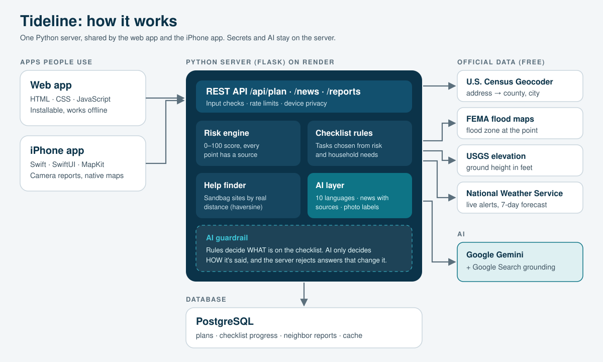
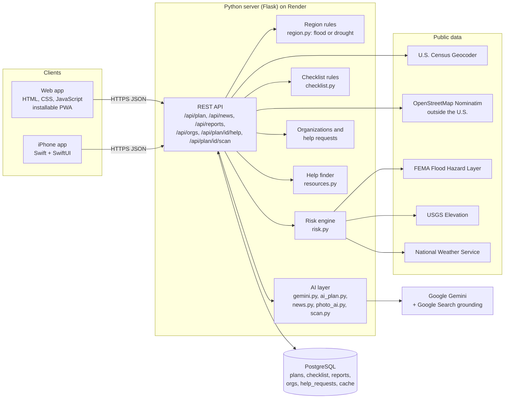

# Swell architecture

Swell helps households and farmers get ready for the 2026–27 El Niño, anywhere in the world. You say who the plan is for (a home or a farm) and give it an address, and it returns:
- a risk score built from official public data, with every point explained. In California El Niño means floods; in Nepal and much of South Asia it means drought, and the plan changes to match.
- a checklist for your household or farm, in your language
- AI Scan: a photo of your home, yard or farm becomes new checklist steps
- a way to ask local organizations for help, and a dashboard for organizations to accept requests
- the nearest places to get sandbags and official help
- live alerts, El Niño news with sources, and a map where neighbors report flooding

This document explains how it's built and why. It's updated with every new feature (see the change log at the bottom).





## Layers

| Layer | What it does | Built with |
|---|---|---|
| **Clients** | What people tap and see. Both apps share the same server, so a plan made on the web shows up on the phone. | Web: HTML, CSS, JavaScript (PWA). iPhone: Swift, SwiftUI, MapKit, PhotosUI |
| **API** | One set of web addresses (`/api/...`) that both apps call. Checks inputs, enforces rate limits, and keeps each device's plans private. | Python 3.12, Flask |
| **Logic** | Turns raw data into decisions. The risk score and checklist are plain Python rules, so they're predictable and testable. | `risk.py`, `checklist.py`, `resources.py` |
| **AI** | Language and judgment: rewrites the checklist in 10 languages, finds and summarizes news with real source links, labels flood photos, and turns AI Scan photos into checklist steps. | Google Gemini API, Google Search grounding |
| **Data** | Saved plans, checklist progress, neighbor reports, organizations, help requests, and a cache of outside answers. | PostgreSQL in production, SQLite on a laptop (same SQL) |
| **Public data** | Official facts about a location. | U.S. Census Geocoder, FEMA NFHL, USGS EPQS, NWS API, OpenStreetMap Nominatim, NOAA Climate Prediction Center (regional El Niño effects) |

## Why I chose each technology

- **Python + Flask for the server.** Python has the best tools for working with data and AI, and Flask is small enough that every line of the server is mine and I can explain it. I didn't need a large framework for a JSON API.
- **A server at all (instead of calling AI from the browser).** My first app, StreetVoice, called the AI straight from the browser, so every user had to paste in their own API key. That's not how real apps work, and it's not safe. Here the Gemini key lives only on the server, in an environment variable, and never reaches the phone or the browser.
- **PostgreSQL in production, SQLite locally.** Postgres is a real multi-user database. Render hosts it, and everyone's reports land in one place. SQLite needs no setup, so I can run the whole app and its tests on my laptop. `db.py` lets the same SQL run on both.
- **Official public data instead of AI for the risk score.** A risk number for someone's home has to be consistent and checkable. FEMA, USGS and the National Weather Service are the official sources, they're free, and the same address always gets the same score. The AI never decides anyone's risk.
- **Gemini for language and search.** One model family handles text, images and Google Search grounding. Grounding matters because news summaries come with the real links the model used, so people can check them. It also has a free tier, which matters for a student project.
- **Gemini Pro for AI Scan.** Reading a photo the way an inspector would is the hardest AI job in Swell, so AI Scan asks the stronger Pro model first and falls back to Flash if Pro is busy or out of quota.
- **A web app *and* a native iPhone app.** The web app works on any phone with no download, which matters for people who won't install an app during an emergency. The iPhone app adds the camera, maps and notifications that feel native, and it's the path to the App Store.
- **Render for hosting.** It deploys straight from GitHub, runs Python, hosts Postgres, and has a free tier. The whole setup is one file: `render.yaml`.

## What happens when you build a plan (`POST /api/plan`)

0. **Who is it for?** The app sends a role: `household` or `farmer`. Farmers also say what they grow or raise, whether people work on the farm, and whether there's a creek or canal nearby.
1. **Find the place.** The Census Geocoder turns the address into coordinates, county and city. If it can't match, OpenStreetMap Nominatim is tried next. "Use my location" goes the other way, with reverse geocoding.
   **Pick the hazard** (`region.py`). The place's state or country maps to one of 10 world regions from NOAA's Climate Prediction Center. If El Niño makes that region drier (Nepal, India, Bangladesh, Indonesia, Australia and others), the plan is a **drought** plan. Otherwise it's a **flood** plan.
2. **Collect live data** (U.S. only). Each source is fetched on its own with a timeout, so if one fails, the rest still work:
   - FEMA flood zone at that exact point
   - USGS ground elevation in feet
   - NWS active alerts and 7-day forecast
   - King tide windows for Bay Area counties (from San Mateo County Parks)
3. **Score the risk** (`risk.py`). This gives 0–100 points, each tied to a source:

   | Factor | Points |
   |---|---|
   | FEMA high-risk zone / moderate / unmapped | +40 / +20 / +5 |
   | Ground under 10 ft / under 25 ft | +25 / +12 |
   | King tides on low ground in a Bay Area county | +10 |
   | NWS storm warning / watch / advisory | +30 / +15 / +8 |
   | 70%+ / 50%+ chance of rain this week | +10 / +5 |
   | Strong El Niño forecast: California / other El Niño regions | +5 / +20 |
   | Farm or ranch (income depends on the weather) | +10 |

   55 or more is **High**, 30–54 is **Elevated**, and under 30 is **Lower**.
4. **Find help** (`resources.py`). This pulls the county's official alert system (for example SMC Alert) and hand-checked sandbag sites. Each site's address is geocoded and sorted by real distance using the haversine formula. For counties not checked by hand yet, an AI web search finds sites, and the app labels them "Found by AI search, confirm before you go," with source links.
5. **Build the checklist** (`checklist.py`). Rules choose the tasks from the hazard, the role, the risk factors and the household: older adults, no car, powered medical devices, pets, renters and hillside homes. Farm plans add tasks for crops, animals, workers and water, with links to USDA disaster programs in the U.S. Drought plans focus on storing water, drought-tolerant seed and a late monsoon, with Nepal's own government sources. Tasks are grouped as *Do this week*, *Have at home*, and *If a storm hits*.
6. **Personalize with AI** (`ai_plan.py`). Gemini rewrites the tasks in the household's language and writes a two-sentence summary. **Guardrail:** the server checks that the AI returned exactly the same task ids. If it dropped or added a task, the AI version is thrown out and the original is kept. Safety numbers (gallons, inches, days, phone numbers) must stay unchanged.
7. **Save and return.** The plan is saved under the device's anonymous id, and the app gets everything in one JSON response.

## Database

```
plans            id, device_id, label, address, lat, lon, county, city, state,
                 language, household (JSON), risk (JSON), checklist (JSON), created_at, updated_at
checklist_done   plan_id, item_id, done_at                  (one row per finished task)
reports          id, device_id, kind, title, note, severity, lat, lon, county,
                 photo, ai_checked, confirmations, status, created_at
report_confirms  report_id, device_id                       (one "I see this too" per device)
cache            key, value (JSON), expires_at              (saved outside answers)
orgs             id, name, about, services (JSON), area, lat, lon, radius_miles,
                 email, phone, website, verified, example, key_hash, created_at
help_requests    id, plan_id, device_id, need, details, contact, lat, lon, area,
                 status (open, accepted, done, cancelled), org_id, created_at, updated_at
```

**Matching help.** When someone asks for help, every organization that offers that kind of help, and whose service area (a radius in miles) covers the person, sees the request. The first to tap "I can help" gets it.

**Caching.** Flood zones and elevation barely change, so they're cached for 30 days. Alerts are cached for 5 minutes, the forecast for 1 hour, and news for 6 hours. This keeps the app fast and inside the free limits of every outside service. A test proves a second plan for the same address makes no new FEMA calls.

## API

| Method and path | What it does |
|---|---|
| `POST /api/plan` | Build and save a plan from an address or coordinates, a language and a household |
| `GET /api/plan/{id}` | Reopen a plan, with fresh alerts and forecast |
| `GET /api/plans` | This device's saved places |
| `POST /api/plan/{id}/check` | Mark a task done or not done |
| `DELETE /api/plan/{id}` | Delete a plan |
| `GET /api/news?county=&state=&lang=` | El Niño news with sources |
| `GET /api/regions` | How El Niño affects different parts of the world |
| `GET /api/enso` | Current El Niño status and emergency declarations |
| `GET /api/reports?lat=&lon=&miles=` | Neighbor reports nearby |
| `POST /api/reports/analyze` | AI labels a photo (kind, title, severity, safety tip) |
| `POST /api/reports` | Post a report |
| `POST /api/reports/{id}/confirm` | "I see this too" (once per device) |
| `POST /api/reports/{id}/clear` | Mark a report cleared |
| `POST /api/plan/{id}/scan` | AI Scan: look at a photo and add what it finds to the checklist |
| `GET /api/plan/{id}/help` | This plan's help requests and who accepted them |
| `POST /api/plan/{id}/help` | Ask for help (kind, details, contact) |
| `POST /api/plan/{id}/help/{rid}/cancel` | Cancel a request |
| `GET /api/orgs?lat=&lon=` | Organizations whose service area covers this spot |
| `POST /api/orgs` | An organization signs up and gets a private key (shown once) |
| `GET /api/orgs/{id}/dashboard` | Requests near the organization (needs its key) |
| `POST /api/orgs/{id}/requests/{rid}/accept, done, release` | Accept, finish or give back a request (needs its key) |
| `POST /api/orgs/{id}/verify` | Swell team marks an organization verified (needs the admin token) |

## Privacy and safety

- **Accounts that protect privacy.** An account is a first name, an email and a password. The password is stored only as a salted scrypt hash. Every account is tied to one private device id, so logging in on another phone brings your plans with you, and plans you made before signing up move into the account. You can still try the app without an account. A test checks that another device gets "not found."
- **Communities.** You can join the county and city communities for places you have a plan for (not any place in the world), and see storm reports from that area. Family groups are private, up to 5 people, joined with a 6-character invite code. Members see each other's places, checklist progress and "I'm safe" check-ins, never exact addresses.
- **Secret keys live only on the server,** in environment variables. `.gitignore` keeps `.env` files out of GitHub.
- **Help requests protect location.** Organizations that haven't accepted a request see only a rough area (coordinates rounded to about half a mile) and no contact. Only the group that accepts sees the exact spot and phone or email.
- **Organization keys are never stored.** The server keeps only a SHA-256 hash of each key and compares with a constant-time check. On iPhone, the key is saved in the Keychain. Organizations show as unverified until an admin with a separate secret token verifies them.
- **Every database value is passed as a parameter,** never pasted into SQL, which prevents SQL injection.
- **Inputs are checked.** Coordinates must be in range, photos must be compressed JPEGs under about 700 KB, and requests are capped at 2 MB.
- **Rate limits** on AI and data routes protect the free quotas.
- **The AI is told never to describe people in photos.** It can't change the safety steps (enforced by the id check), and every AI-written news summary links to its sources.
- **The app always says** "In an emergency, follow official orders and call 911." It helps people prepare; it does not replace official warnings.

## Testing

`backend/tests/` has 27 automated tests (Python `unittest`). They run offline with fake versions of every outside service that return the same JSON shapes as the real ones. They cover:
- **Risk scoring:** a Bayfront home, a hillside home, past king tides being dropped, and FEMA zone wording.
- **Checklist rules:** household needs adding tasks, and a low-risk home still getting the basics.
- **The full plan flow,** including the Spanish version.
- **The AI guardrail:** an AI answer that drops a task is rejected.
- **Outages:** a plan is still built when FEMA, USGS, the weather service and the AI are all down.
- **Bad inputs, privacy between devices, and AI help search with sources.**
- **News with sources, the report flow** (including once-per-device confirmations and rejected non-photo uploads), and caching.
- **Farmers and regions:** a California farmer gets a flood farm plan, and a farmer in Chitwan, Nepal gets a drought plan.
- **AI Scan:** a scan adds tasks to the checklist, most urgent first, each with where it is in the photo and how to fix it; low-confidence guesses are dropped; scanning the same photo twice doesn't add them twice.
- **Organizations and help:** the full flow (ask, match, accept, contact revealed only to the accepting group, done), verification needing the admin token, and sign-up checks.

Browser tests (Playwright) click through the whole web app in light and dark mode: onboarding, plan, checklist, help, report with photo, news, and a second place in Spanish.

Run them:
```
cd backend
python -m unittest discover tests -v
```

## Hard problems I solved

1. **Making AI safe for emergency information.** AI is great at translating and explaining, but it can leave things out. I split the job: rules decide *what* is on the checklist, and the AI only decides *how it's said*. Then the server verifies the AI's answer against the rules before using it.
2. **Outside services fail, especially during storms.** Each data source is fetched separately with a timeout. If FEMA or the weather service is down, the plan is still built from what worked, and the app tells you what's missing.
3. **Rate limits and speed.** The cache table stores outside answers with different lifetimes depending on how fast the data changes.
4. **Sandbag sites change during the season.** Hand-checked sites carry their source link and the date I checked them. AI-found sites are clearly labeled as unverified.

## Roadmap

- **Push notifications** when the NWS issues a warning for a saved place, using a scheduled job that checks each saved plan.
- **iPhone app on the App Store** after testing with families, then Android.
- **Text-message (SMS) version** for people without smartphones or data, and in-app voice reading of the plan for people who don't read well.
- **A full Nepal version.** Swell already builds drought plans in Nepali. Next: work with farmers there, add Nepal's weather alerts, and support SMS for phones without data.
- **Bringing Swell to San Mateo County's new storm-season task force and OneShoreline,** so neighbor flood reports can reach public works crews.
- **Real partner organizations,** starting with SVYCA San Mateo County, verified before they appear as trusted.
- **More counties:** hand-check sandbag sites across California.

## Change log
- **Oct 23, 2026:** Python API, database, risk engine, checklist rules, AI translation with guardrail, help finder, news, neighbor reports, web app, and 20 tests.
- **Oct 23, 2026:** Renamed to Swell. Added the farmer role, drought plans for South Asia and other El Niño regions, AI Scan, organizations and help requests. 26 tests.
- **Oct 23, 2026:** Stronger AI Scan: Gemini Pro first, an inspector's checklist for flood or drought and home or farm, up to 8 findings with where, why, fix and effort, low-confidence findings dropped, plus what's already done right and one more photo to take.
- **Oct 24, 2026:** Accounts (scrypt-hashed passwords), communities (county, city, private family groups of 5 with "I'm safe"), a new Community tab next to the Map (each community has its own map), worldwide facts on the welcome screen, and a start script that checks the Gemini key. 27 tests.
- **Oct 23, 2026:** iPhone app caught up with the web app: home or farm, farm details, AI Scan, region card, ask for help, and the organization dashboard.
